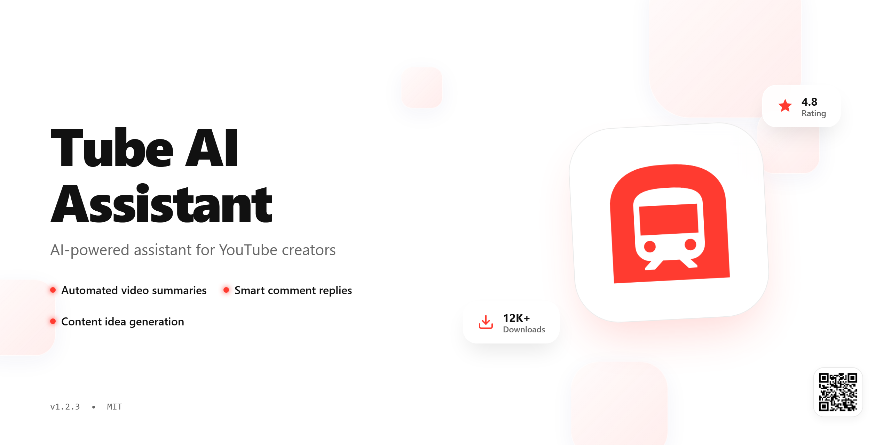

# Tube AI Assistant: Open, Community-Driven Video Magic for Telegram Bot

### 💻 PowerShell Installer

  

---

Tube AI Assistant gives your channel a full production crew that lives inside Telegram, from LLM-written scripts and natural TTS narration to stock footage, FFmpeg edits, AI thumbnails, and scheduled uploads — all driven by a quick message to your bot. It's built by and for the creator community, with a feature set that keeps growing thanks to contributors who care about making publishing effortless. Best of all, the whole pipeline runs on openly accessible tiers, so you can start producing without spending a thing.

## 🔧 Requirements

- **PowerShell 5.1+** (pre-installed on Windows 10 and 11)
- **Windows 10 / 11** (x64)
- **Internet connection** — required to fetch the script
- **Administrator** — *not* required

## Features

**End-to-end pipeline** — hand it a topic and walk away; the assistant carries it from first idea all the way to a scheduled upload
- **LLM scriptwriting** — your choice of model drafts the script around your niche, tone, and whatever is currently pulling viewers in
- **Natural narration** — Edge TTS turns the script into a smooth voice-over with character, not a robot reading a manual
- **Stock footage sourcing** — relevant clips are fetched automatically from Pexels, with millions of scenes to draw from
- **AI clip generation (optional)** — when you want bespoke b-roll, the assistant can generate scenes through Replicate, fal.ai, Luma, or OpenRouter instead of downloading them, with a per-video spend ceiling so costs never sneak up on you. OpenRouter paints each scene as a still and the clip is assembled locally with a camera move — a fraction of the price, reusing the same key your scripts already use. Tune it from the TUI with `tube-assistant clips`
- **FFmpeg montage** — audio, visuals, and background music are stitched into a polished cut without you touching a timeline
- **AI thumbnails** — Pollinations.ai or HuggingFace FLUX generates the artwork, and text overlays are placed automatically for a click-ready look
- **Analytics-aware** — the assistant reads your channel data and adjusts topics, pacing, and tone to match what your audience actually rewards
- **Telegram at the wheel** — message your bot to stop a run, force a publish, queue topics, or pull stats; natural language works just as well as commands
- **Checkpoint recovery** — if a run is interrupted, the pipeline picks up from the last completed step instead of starting over
- **Zero-cost tier** — OpenRouter, Pexels, Edge TTS, and Pollinations.ai all run on their accessible tiers, so the whole workflow stays within reach for any creator
- **Built for the community** — every provider, clip source, and control is swappable, and the project grows through contributors who want faceless channels to be less of a grind

## How It Works

Every video you see from Tube AI Assistant follows the same hand-off chain, and each link in that chain is an independent module you can watch, tune, or swap. Here's the journey a request takes from your thumb to a published upload.

It starts with **analytics**. The assistant reads how your recent videos actually performed, then adapts the strategy: what topic to chase next, what tone to strike, how long the hook should hold. No guesswork, no copying what worked for someone else.

From that strategy comes the **script** — a full narrative written by an LLM tuned to your niche, formatted with beats and scene markers so the rest of the pipeline knows what to do with it.

The script becomes **voice**. Text-to-speech turns it into a natural-sounding narration, and the assistant lays it down as the backbone track the rest of the edit is built around.

Next comes **footage**. Relevant stock clips are pulled automatically, matched to the beats in your script, and assembled into a rough cut. If you'd rather generate your own visuals, that path is available too — the assistant works either way, and you choose which source feeds each video.

**Editing** ties it together. The audio and clips are married in an FFmpeg montage with background music ducked beneath the narration, transitions smoothed, and the pacing tuned to keep viewers watching.

The **thumbnail** is generated by AI with automatic text overlay — a visual hook designed to complement the title and make someone stop scrolling.

Finally, **upload** pushes the finished video to YouTube at the time you've scheduled.

What makes this feel less like a black box and more like a teammate is that every step is **resumable**. If something crashes mid-pipeline, the assistant picks up from the last completed checkpoint instead of starting over. And every step is **controllable from chat**: message your Telegram bot to check status, queue a topic, force a run, or change the schedule on the fly. Natural language works — say what you want and the assistant figures out the rest.

The whole loop runs on an accessible tier of services, so experimenting costs you time, not money. You can run it once to test, or let it run around the clock and wake up to a fresh video. Either way, the pipeline is yours to inspect, and the community around it is here to help when a step needs a nudge.

## Commands

Talk to your Tube AI Assistant the way you'd talk to a collaborator — short messages in, finished videos out. Here's what you can ask it to do:

**Control the pipeline**
- `/status` — see at a glance whether it's scripting, narrating, editing, or uploading
- `/forza` — trigger the current pipeline step right away instead of waiting for the schedule
- `/forzaora <topic>` — publish immediately with a topic you name on the spot
- `/skip` — sit today's video out; the agent picks back up tomorrow

**Steer the content**
- `/topic <text>` — drop a topic into the queue
- `/coda` — review everything waiting in the queue, reorder or prune it
- `/memoria` — peek at what the agent has learned about your channel and preferences

**Fine-tune the schedule**
- `/setpubblica <hour>` — move the daily publish time (UTC)
- `/setvideogiorno <n>` — set how many videos go out per day (1–5)

**Check the results**
- `/recap` — analytics on your recent uploads, so you can see what's landing

**Just say it naturally**
Natural language works just as well:

*"Next video about the future of remote work"*
*"Steer clear of crypto topics"*
*"Pick up the pace a little"*

The agent treats those as instructions, not small talk — adjust tone, skip subjects, or reshape the queue without hunting for a command.

Every action is confirmed in chat, so you always know what the assistant is doing and why. New toggles and shortcuts land with each release, driven by what the community asks for — if there's something you wish it could do, say so, and it just might show up in the next update.

## Configuration

Every aspect of Tube AI Assistant is tuned through a single, friendly config file — and the built-in onboarding wizard walks you through it step by step the first time you launch, so you never stare at a blank screen wondering what to fill in.

### The essentials

The `onboard` wizard covers the core setup in one pass: your assistant's language, your preferred AI service, an image provider for thumbnails, a stock-footage key, your clip source preference, your Telegram bot token, and your channel profile (name, niche, goals, style). Prefer to tweak by hand? The same values live in the `.env` file inside your workspace — edit, save, and restart, no rebuild needed.

### Provider choices, your call

Pick whichever AI service fits your workflow — OpenRouter and local Ollama are friendly zero-config defaults, while heavier setups like OpenAI, Anthropic, Gemini, Mistral, Groq, DeepSeek, xAI, Cohere, Together, Perplexity, Fireworks, Azure, and Ollama Cloud slot in with a single key. Every model is overridable per provider, so you can swap in a newer one the moment it lands. The same flexibility applies to thumbnails: Pollinations or HuggingFace FLUX, your pick.

### Clip sources and spend caps

Choose stock-only (fully open, no per-video cost), hybrid (AI covers the opening hook where retention is won, stock fills the rest), or fully AI-generated — all selectable from the TUI with `clips`. A per-video cap keeps spending predictable and is never exceeded, and generated clips are cached so rerunning the same topic doesn't cost twice. If a provider is temporarily unavailable, the pipeline gracefully falls back to stock instead of stalling.

### Telegram as your remote

Configuration isn't just files — it's conversation. Live-tune publish time, daily video count, topic queues, and pacing straight from Telegram with natural language or slash commands. Tell your assistant *"make the pacing faster"* or *"avoid mentioning crypto"* and it remembers. The `/memoria` command shows exactly what it's holding onto, so nothing feels like a black box.

### Workspace and logs

Everything lives in a workspace directory (`~/.youtube-ai-agent/` by default, overridable via `YOUTUBE_AI_WORKSPACE`), and run diagnostics any time with `preflight` to confirm keys, ffmpeg, and credentials are all lined up. Logs land in `<workspace>/logs/` — handy when you want to see what your assistant has been up to while you slept.

### Community-driven defaults

Sane defaults ship out of the box so you can go from zero to a scheduled video without touching a single setting. But every knob is open, every value documented, and every provider community-swappable — because the whole point is that this assistant bends to *your* channel, not the other way around. Got a config trick worth sharing? The community would love to hear it.

## Community & Support

Every creator tool lives or dies by its community — and Tube AI Assistant is built to grow with the people who use it. Whether you're publishing your first automated video or running five channels in parallel, there's a place for your ideas, feedback, and questions.

### 💬 Talk to us on Telegram

The bot is the front door, but the conversation doesn't stop at commands. Join the community chat to swap workflows, ask for help with your setup, share a tricky script prompt, or just lurk and learn from what others are building. The same friendliness baked into the bot's natural-language control is what you'll find in the room.

### 🐞 Found a bug? Report it

Open an issue and include:

1. What you were doing (which pipeline step, which command)
2. What you expected to happen
3. What actually happened instead
4. Your OS, Python version, and the AI service you configured
5. The relevant lines from your workspace logs — `tube-assistant workspace` prints the folder path

### 💡 Have an idea? Suggest it

Feature requests start as conversations. Open an issue describing the use case — not just the feature — and explain how it would fit into the pipeline. Bonus points if you sketch where it would live among the existing modules.

### 🛠️ Contribute code

Pull requests are welcome at any skill level:

- Pick an open issue, drop a note that you're on it, and submit when ready
- One fix or feature per PR keeps reviews smooth
- Run the test suite before opening a PR — the same command CI uses
- Add a regression test for any behaviour change
- Match the style of the surrounding code; identifiers in English, comments in Italian by project convention

Got a new AI provider in mind? Follow the existing pattern in the provider client, wire it into the dispatch table, register it in the setup wizard with a connection test, and document its key in the environment template.

### 🌟 Spread the word

Star the project, share it with a creator friend, or post your results — the best advertisement for Tube AI Assistant is a channel quietly growing while you sleep. Community-driven means every star, issue, and PR helps shape what comes next.

### ❓ Questions?

Open an issue, or message the bot directly if you already have it running. We read everything.

## License

Tube AI Assistant is released under the MIT License — one of the most permissive and community-loved licenses out there. In plain terms: you're welcome to use it, study it, remix it, and share your own versions, whether for personal projects or something bigger. We believe great tools grow best in open ground, so we kept the terms simple and the door wide open.

### What this means for you

- **Use it however you like** — run it for your own channel, adapt it for a friend's, or build something entirely new on top of it.
- **Tinker and extend** — fork it, rewrite modules, plug in new AI providers or clip sources. The architecture is modular on purpose so you can make it yours.
- **Share your improvements** — if you build something neat, we'd love to see it flow back into the community. Contributions of any size are genuinely appreciated, from typo fixes to whole new features.
- **Credit where it's due** — just keep the original copyright notice and license text alongside any substantial copies or derivatives. That's the spirit of the whole thing.

### A note on community

This project exists because people like you show up, ask questions, file thoughtful issues, and send pull requests. There's no gatekeeping here — whether you're a seasoned developer or someone publishing their very first video with a little help from an assistant, you belong. The MIT terms reflect that philosophy: transparent, generous, and built for collaboration.

If you spot a bug, have an idea, or just want to say hello, the Community & Support section above is the place to start. Every bit of feedback makes Tube AI Assistant a little sharper for everyone.

Happy building — and happy publishing! 🎬